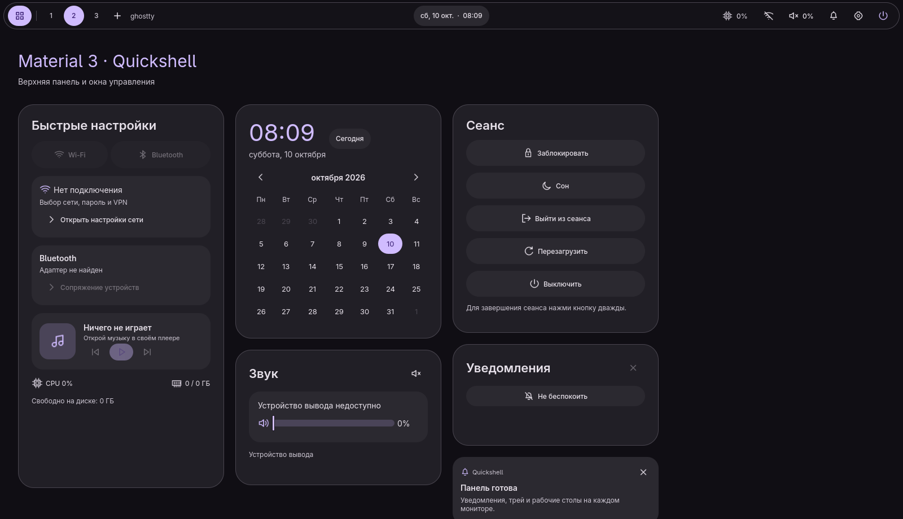

# md3 dotfiles

Hyprland в стиле Material Design 3: своя оболочка на Quickshell (панель, док, меню),
цвета всего рабочего стола из обоев и темы для Discord, Spotify и Steam.



## Установка (Arch Linux)

```sh
git clone https://github.com/vvaeli/dotfiles ~/dotfiles
cd ~/dotfiles
./install.sh            # пакеты + конфиги
./install.sh --greeter  # то же + экран входа в стиле md3 (greetd + ReGreet)
```

Потом выйди из сеанса и зайди в **Hyprland**. Если пакеты уже стоят, запускай с `--no-packages`.

Установщик ничего не удаляет: всё, что он заменяет (в том числе весь старый
`~/.config/hypr`), переезжает в `~/.local/state/md3-dotfiles/backup-<время>/`.
Повторный запуск безопасен.

## Что внутри

- **Панель:** рабочие столы по мониторам, трей с меню в стиле оболочки, звук и
  выбор выхода, Wi‑Fi, Bluetooth, VPN, уведомления. Меню перетекают одно в другое.
- **Центр управления** (клик по часам): быстрые плитки, громкость, календарь,
  плеер с визуализатором и лучами в цвет обложки.
- **Док** с перетаскиванием иконок.
- **Лаунчер** (`Super+R`): приложения, файлы, `=` калькулятор.
- **Обои → цвета:** выбираешь обои в меню, и matugen перекрашивает оболочку, рамки
  окон Hyprland, экран блокировки, GTK/Qt, Ghostty, btop, Discord, Spotify, Steam
  и экран входа. Есть светлая и тёмная тема, поддерживаются видео-обои.
- **Скриншоты как в ShareX** (`Print`): выделение, редактор Satty, буфер обмена.
- **Ночной свет**, OSD громкости и яркости, история буфера обмена, свой выбор
  окна при демонстрации экрана.
- Блокировка (`Super+L`), автоблокировка через 10 минут.

Все клавиши: `~/.config/hypr/README.md`. Подробно про оболочку: `~/.config/quickshell/md3/README.md`.

## Настроить под себя

- **Мониторы:** `~/.config/hypr/conf/monitors.lua`. По умолчанию каждый экран
  работает в родном разрешении с автоматической раскладкой.
- **Обои:** кидай картинки и видео в `~/Pictures/Wallpapers`, выбирай в меню обоев.
- **Терминал и файловый менеджер:** `~/.config/hypr/conf/programs.lua`.
- **Раскладки и ввод:** `~/.config/hypr/conf/input.lua`.

## Темы приложений

Установщик включает их сам, если приложение уже стоит:

| Приложение | Что нужно заранее |
|---|---|
| Discord | [Vencord](https://vencord.dev) |
| Spotify | [Spicetify](https://spicetify.app) |
| Steam | [Millennium](https://steambrew.app) (`paru -S millennium`) |

Если приложение поставлено после установки, просто запусти `./install.sh --no-packages` ещё раз.

## Для автора: обновить репозиторий

```sh
./sync.py && git add -A && git commit -m "update"
```

`sync.py` копирует живые конфиги из `$HOME`. Бэкапы, кеш, тестовые файлы, RGB,
диски и раскладка мониторов в репозиторий не попадают. Путь к домашней папке
сохраняется как `@HOME@`, имя пользователя — как `@USER@`.
