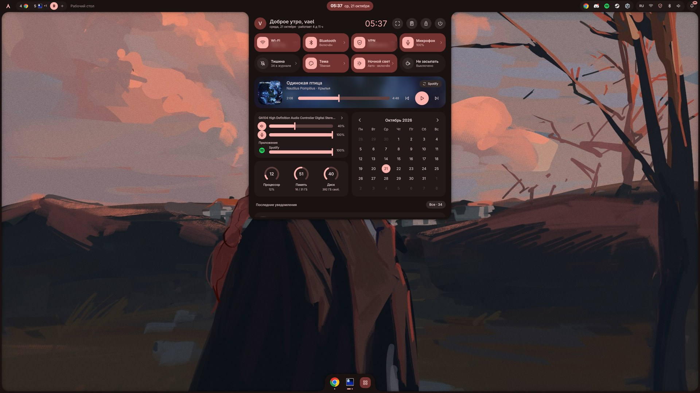
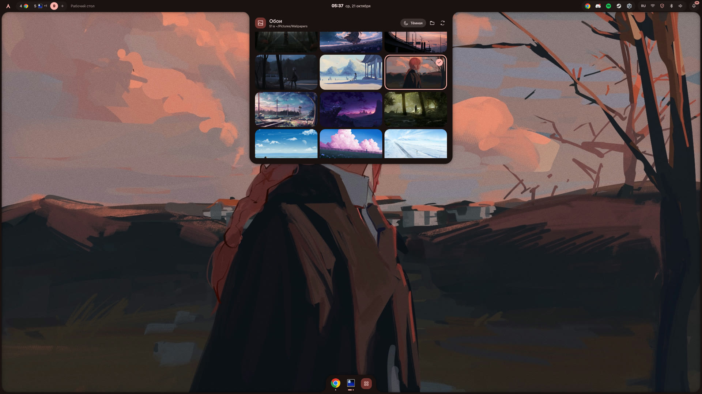
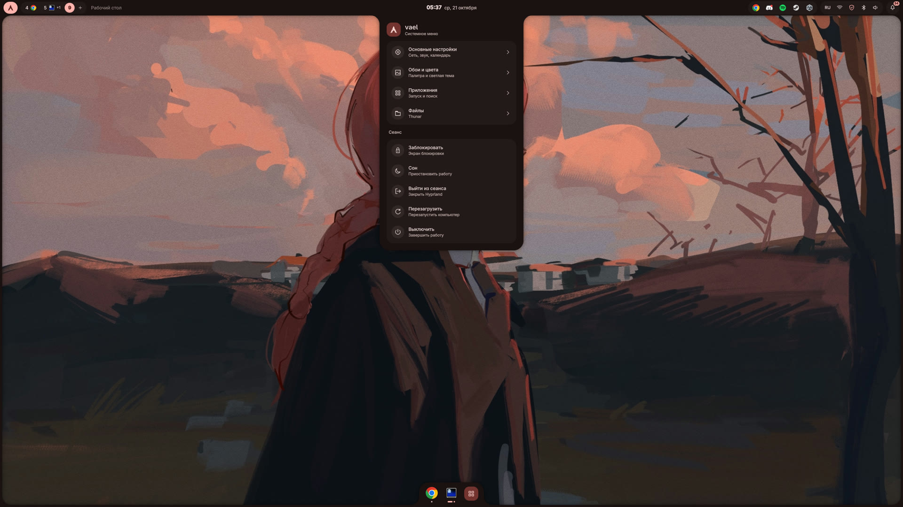
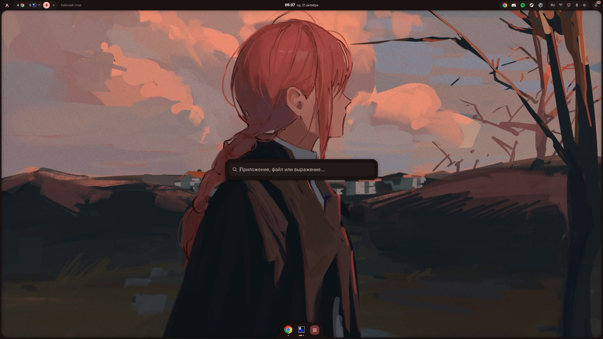
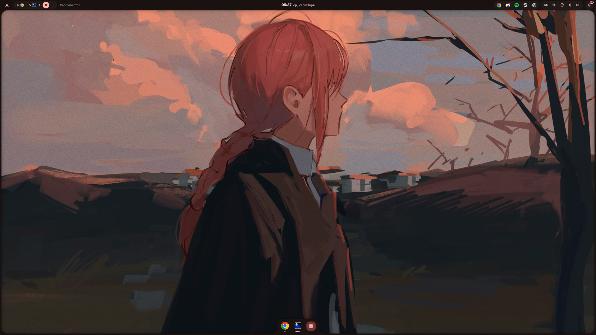

<div align="center">

# md3 · Hyprland

**Hyprland в стиле Material Design 3.** Оболочка написана с нуля на Quickshell,
и весь рабочий стол, от рамок окон до Discord и Steam, перекрашивается под твои обои.




</div>

---

## ⚡ Установка

```sh
git clone https://github.com/vvaeli/dotfiles ~/dotfiles
cd ~/dotfiles && ./install.sh
```

Дальше выйди из сеанса, выбери **Hyprland** и заходи. Всё.

| Флаг | Что делает |
|---|---|
| *(без флагов)* | ставит пакеты (pacman + AUR через paru/yay) и раскладывает конфиги |
| `--no-packages` | только конфиги, если пакеты уже стоят |
| `--greeter` | ещё и экран входа в стиле md3 (greetd + ReGreet) |

> [!NOTE]
> Установщик **ничего не удаляет**. Всё, что он заменяет, включая весь старый `~/.config/hypr`,
> уезжает в `~/.local/state/md3-dotfiles/backup-<время>/`. Запускать повторно безопасно.

---

## 📷 Скриншоты

<table>
<tr>
<td><p align="center"><sub>Обои → цвета (<code>Super+W</code>)</sub></p></td>
<td><p align="center"><sub>Системное меню</sub></p></td>
</tr>
<tr>
<td><p align="center"><sub>Лаунчер (<code>Super+R</code>)</sub></p></td>
<td><p align="center"><sub>Рабочий стол: панель, рамка, док</sub></p></td>
</tr>
</table>

---

## ✨ Фичи

### 🎨 Обои задают цвета всего
Выбираешь обои (`Super+W`), [matugen](https://github.com/InioX/matugen) вытаскивает из них палитру,
и за секунду перекрашивается всё это:

<table>
<tr><td>

- панель, док, меню, уведомления
- рамки и тени окон Hyprland
- экран блокировки и экран входа
- GTK 3/4, libadwaita, Thunar, Qt

</td><td>

- Ghostty, btop
- **Discord** (Vencord)
- **Spotify** (Spicetify)
- **Steam** (Millennium)

</td></tr>
</table>

Светлая и тёмная тема переключаются одной кнопкой. Видео-обои тоже поддерживаются.

### 🧭 Панель
- Рабочие столы отдельно для каждого монитора, `+` создаёт новый стол.
- Трей с меню в стиле оболочки, без кривых системных попапов.
- Звук с выбором выхода, Wi‑Fi, Bluetooth с сопряжением прямо из меню, VPN.
- Меню не прыгают, а **перетекают** одно в другое и меняют размер на лету.
- Уведомления вырастают прямо из панели.

### 🎵 Центр управления
Открывается кликом по часам: быстрые плитки, громкость, календарь и **плеер с
визуализатором**. Лучи за плеером окрашиваются в цвета обложки трека.

### 🚀 Лаунчер
`Super+R`: приложения, поиск файлов по дому и дискам, `=2+2` калькулятор.

### 📸 Скриншоты как в ShareX
`Print`: выделяешь область, рисуешь, жмёшь Enter, и снимок уже в буфере и в `~/Pictures/Screenshots`.

### 🧩 И по мелочи
Док с перетаскиванием иконок · история буфера обмена · ночной свет · OSD громкости и яркости ·
свой выбор окна для демонстрации экрана в Discord/браузере · прицел для игр · автоблокировка.

---

## ⌨️ Клавиши

| Клавиши | Действие |
|---|---|
| `Super` `Enter` | терминал (Ghostty) |
| `Super` `R` / `Space` / `D` | лаунчер |
| `Super` `E` | файлы (Thunar) |
| `Super` `W` | обои и цвета |
| `Super` `V` | история буфера обмена |
| `Super` `Q` | закрыть окно |
| `Super` `F` | развернуть окно |
| `Super` `T` | плавающее окно |
| `Super` `L` | заблокировать |
| `Super` `B` | спрятать или показать панель |
| `Super` `C` | прицел |
| `Super` `1…0` | рабочие столы |
| `Super` `Shift` `1…0` | перенести окно на стол |
| `Print` | скриншот области |
| `Super` `Print` | скриншот области с редактором |
| `Shift` `Print` | весь экран |
| `Alt` `Print` | активное окно |
| `Super` `M` | выйти из сеанса |

---

## 🛠️ Под себя

| Что | Где |
|---|---|
| Мониторы | `~/.config/hypr/conf/monitors.lua` (по умолчанию автоматически) |
| Обои | `~/Pictures/Wallpapers`, картинки и видео |
| Терминал, файловый менеджер | `~/.config/hypr/conf/programs.lua` |
| Раскладка клавиатуры, мышь | `~/.config/hypr/conf/input.lua` |
| Клавиши | `~/.config/hypr/conf/keybindings.lua` |

Подробно про каждую часть оболочки: [`quickshell/md3/README.md`](home/.config/quickshell/md3/README.md).

## 🎧 Темы приложений

Установщик включает их сам, если приложение уже стоит. Если поставил его позже, запусти `./install.sh --no-packages` ещё раз.

| | Нужно заранее |
|---|---|
| Discord | [Vencord](https://vencord.dev) |
| Spotify | [Spicetify](https://spicetify.app) |
| Steam | [Millennium](https://steambrew.app): `paru -S millennium` |

## ❓ Если что-то не так

- **Панели нет:** `~/.config/hypr/scripts/recover-shell`, лог в `~/.local/state/hypr/quickshell.log`.
- **Цвета не поменялись:** проверь, что стоит `matugen`, и выбери обои ещё раз.
- **Красный щит VPN на панели:** это клиент Beryllium, без него кнопка просто неактивна.

---

<div align="center">

<sub>Анимации по мотивам <a href="https://github.com/caelestia-dots/shell">caelestia</a> · сделано <a href="https://github.com/vvaeli">vvaeli</a></sub>

</div>
